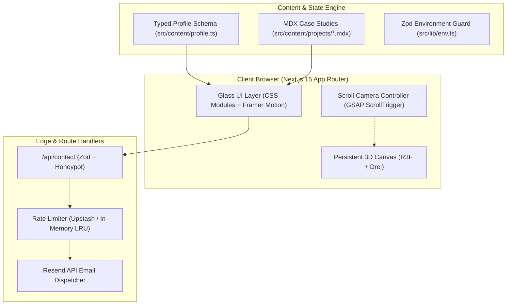

# Architecture Overview

This document outlines the architectural principles, directory layout, rendering strategy, and 3D integration pipeline for Mikul Jain's Full Stack Engineer Portfolio.

## Layer Responsibilities

1. **Presentation (DOM & Glass)**: Server-rendered React components hydrated with Framer Motion for micro-interactions and custom CSS modules for high-performance glassmorphism.
2. **3D Scene Graph (R3F)**: Rendered through a single persistent `<Canvas>` background. Driven by scroll offsets and mouse parallax via `useFrame`.
3. **Data Layer**: Strictly validated schema (`src/content/profile.ts`) and MDX frontmatter with zero unchecked any types.
4. **API & Defense**: Next.js App Router Route Handler protected by client rate limiting, honeypot spam detection, and Zod input validation.
